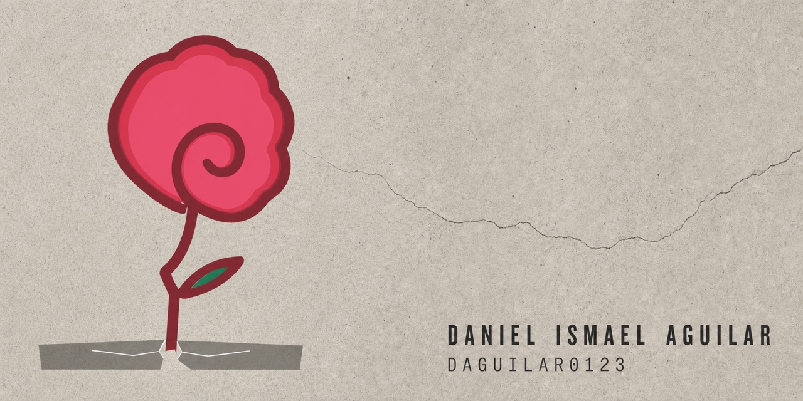

# Daniel Ismael Aguilar

I build research tools, public records projects, and practical software for work that needs more proof and less theater.

The thread through my work is simple: name the source, state the limits, and leave a record other people can check.

## Selected work

| Project | What it does |
|---|---|
| [AI Writing Skill Field Guide](https://github.com/Daguilar0123/ai-writing-skill-field-guide) | Measures the maintenance of 68 open-source AI-writing skills, publishes the data and method, and reports the negative results alongside the successful ones. |
| [Outside Money in the 2026 Maine U.S. Senate Race](https://github.com/Daguilar0123/graham-platner-campaign-finance) | Tracks FEC-reported independent expenditures in a source-linked ledger that is kept separate from editorial conclusions. |
| [Graham Platner: The Record](https://github.com/Daguilar0123/graham-platner-the-record) | Organizes allegations, denials, claimed corroboration, campaign spending, and media coverage into a public verification record with a declared editorial standpoint. |
| [email-agent](https://github.com/Daguilar0123/email-agent) | Teaches the agent loop through a deliberately small email-triage example, with the shortcuts and safety boundaries called out in the code. |
| [YouTube Transcribe Rebuild](https://github.com/Daguilar0123/youtube-transcribe-rebuild) | A macOS-first Tauri app that uses `yt-dlp`, `ffmpeg`, and `whisper.cpp` to turn YouTube videos or local media into local TXT and SRT transcripts. |
| [Receipts Not Vibes](https://github.com/Daguilar0123/receiptsnotvibes-landing) | A dependency-free landing page that turns measured findings into a literal receipt and keeps the failed experiment visible. |

## How I work

My projects favor primary records, reproducible methods, and plain statements about what the evidence cannot prove. That matters most when institutions hold more power than the people described in their records.

I also build to learn. Earlier work includes a [Java media player](https://github.com/Daguilar0123/Sound-Media-Player), a [data structures course repository](https://github.com/Daguilar0123/CompSciIII), and [BookBot](https://github.com/Daguilar0123/BookBot). I keep those projects public because the path into the work belongs beside the polished results.

<!-- Contact: replace this comment with a verified public contact route before publishing. Do not add a private email. -->
